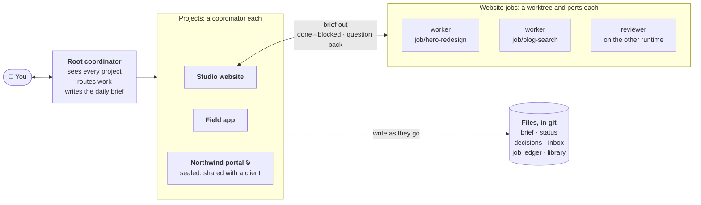
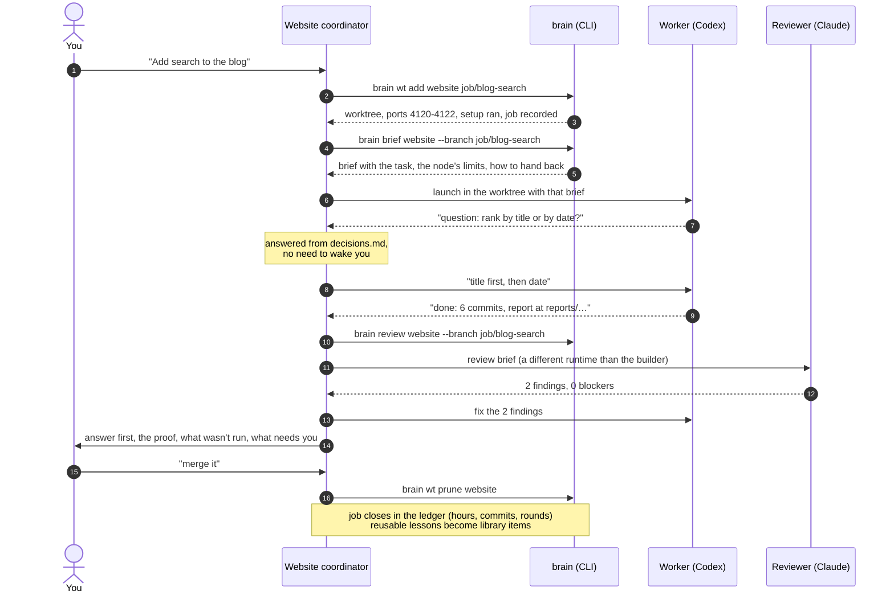
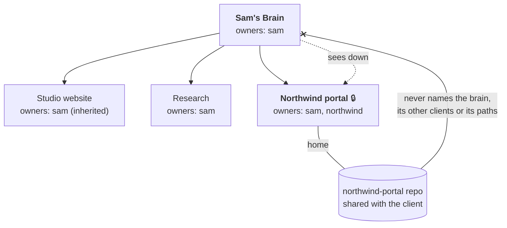
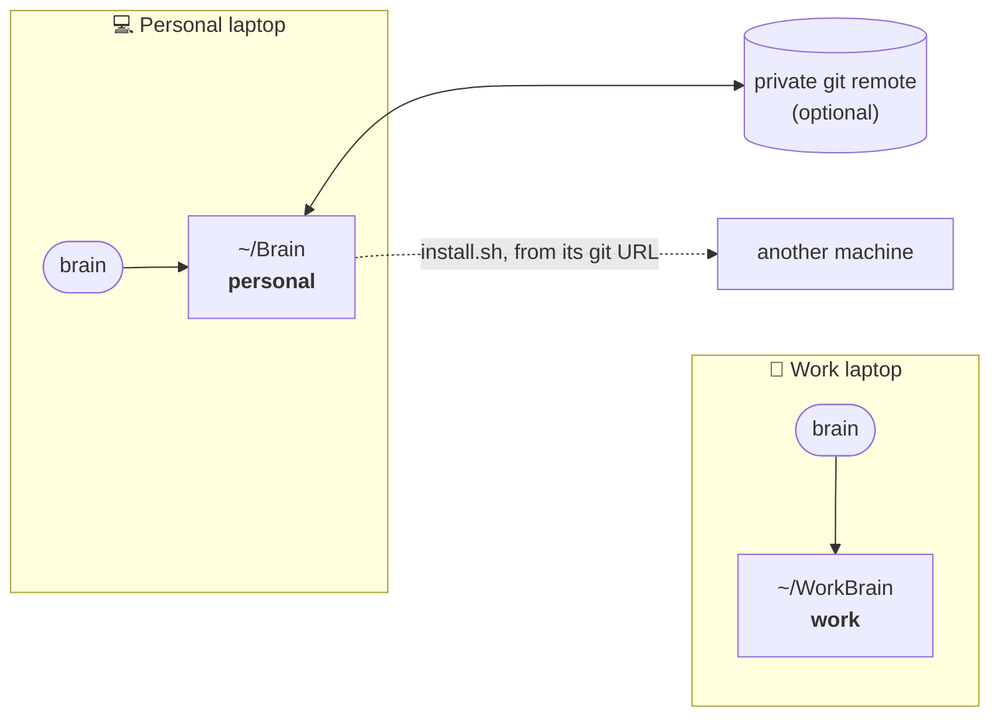

<div align="center">

# 🧠 Brain

**A brain for your AI agents.**<br>
One tree of projects, a coordinator for each, workers that report back instead of guessing,<br>
and every decision written down, so nothing lives only in a chat that's about to scroll away.

Runs on **Claude Code** and **Codex** (or both at once), in **T3 Code** or any host that can start and message threads.<br>
Python 3.9 standard library. Nothing to install but one command.

[Why](#why) · [How it works](#how-it-works) · [A job, start to finish](#a-job-start-to-finish) · [See it](#see-it) · [Install](#install) · [Commands](#commands) · [The model](#the-model) · [Tests](#tests)

<br>

<picture>
  <source media="(prefers-color-scheme: dark)" srcset="docs/img/ui-dark.png">
  
</picture>

<sub>`brain ui` on a demo brain. Every name, project and number in these images is made up.</sub>

</div>

---

## Why

One agent in one repo for one afternoon works fine on its own. The trouble starts when the work is
bigger than one conversation:

| | A bare agent session | With a Brain |
| --- | --- | --- |
| **Memory** | The context window; long runs get compacted and details drift | State lives in files. Any thread can be replaced and picks up exactly where the last one stopped |
| **Decisions** | Somewhere in the chat. "What did I say about X?" becomes a guess | `decisions.md`, each with a timestamp, the reason, the alternatives and your exact words |
| **Many agents** | Nothing stops two of them from taking the same port or the same migration number | One worktree and a block of ports per job, one coordinator per project, a lock on shared files |
| **Many projects** | One repo per session; nothing sees across them | A tree. The root sees every project; each project sees only itself and what's below it |
| **Questions** | A worker asks on a screen nobody is watching | Workers hand questions back to their coordinator; only what the rules don't settle reaches you |
| **Quality** | The model that wrote the change reviews it, if anyone does | A different runtime reviews every change before you're asked to approve it |
| **Learning** | Lost when the session ends | Lessons from each finished job become library items the next job gets in its brief |
| **Consent** | Whatever you repeat in each session | Written rules: no push, deploy, send or anything irreversible without your explicit OK |

For a five-minute fix, skip all of this: open the repository itself. The Brain's rules only apply
inside the Brain.

---

## How it works



- **Nodes** form one tree of any depth: a company, a product, a client, a paper, a side project.
  Each node is a folder with a few files, and optionally its own code repository (its *home*).
- **A coordinator** is one long-lived conversation per node. You can talk to it directly, or to the
  root, which asks the coordinators below it.
- **Workers** do one job each, in their own git worktree with their own ports. They never ask you
  anything: a question goes back to the coordinator, which answers from the rules and the decisions
  already made, and only brings you what they don't settle.
- **Everything is a file.** Threads are disposable; when one ends (or hits a usage limit), the next
  one reads the files and carries on.

### The files of a node

```
nodes/website/
├── node.md          id, owners, labels, runtime, where its home is
├── AGENTS.md        rules for this node (CLAUDE.md links to it)
├── brief.md         what it is, why, who, scope, Limits (each with "Why:" and "Lift when:")
├── status.md        Now · Next · Active work · Blocked / needs you · Recent changes
├── decisions.md     each decision: time, what, Why, Alternatives, and Said: "your exact words"
├── inbox.md         anyone may append a line; only the coordinator clears it
├── job-ledger.md    every job: started, ended, hours, commits, review rounds, outcome, cause
├── never-name.txt   (optional) words this project's code must never contain
├── sources/         material the node works from
└── nodes/           its children, if any
```

One writer per file: the coordinator owns its node's files; everyone else appends to the inbox.
Machine-specific things (thread IDs, local paths, ports) live in `.brain/local.json`, which git
ignores, so the same brain works on every machine that clones it.

---

## A job, start to finish



<details>
<summary><b>The brief the worker gets</b> (from <code>brain brief</code>, demo data)</summary>

```markdown
Role: worker in node `website` (Studio website), started by its coordinator.
Run in: ~/code/website-work/worktrees/job-blog-search  ·  branch job/blog-search  ·  runtime: claude  ·  ports 4120-4122
The rules, agents and skills where you run come first (axiom 7); this brief adds to them.

## Task

Rank results by title match first, then recency. Done when the search page shows the 10 best results in under 100 ms.

## Limits

- At most 3 worktrees at once. Why: each runs a dev server and a browser. Lift when: the CI runners take the browser tests.
- No deploys without Sam. Why: the site takes payments. Lift when: never.

## Questions and hand-back

- **Never ask the operator, and never wait for an answer in this thread**: nobody is watching it.
- **A choice** the task, the rules or this brief settle: make it, and list it in your report under "Decisions I made".
- **A question you can't go on without:** host `send` to thread `demo-web` (T3: t3_thread_send, threadId demo-web) with the question and append `- <time from brain now> from worker: question: <it>` to `~/Brain/nodes/website/inbox.md`, then end your turn with the question as your last line.
- **When you finish, fail or get blocked**, tell your coordinator straight away: host `send` to thread `demo-web` (T3: t3_thread_send, threadId demo-web) with `done|failed|blocked: <one line>. Report: <path>`. Then end your turn.

## Report

The answer first; then the proof (commands, numbers, hashes); what you produced and where; what you did **not** run or check; "Decisions I made"; "Lessons": what the next job should know (a pitfall, a tool's quirk, a method that worked), or "none"; and what is still open.
```
</details>

---

## See it

### In the terminal: `brain`

```
Sam's Brain  ·  ~/Brain  ·  machine studio-mac

root                         updated 30m ago
  mobile-app                 updated 1h ago      in flight 1
  newsletter                 updated 1d ago
  northwind                  updated 3h ago      in flight 1 [sealed]
  research                   updated 20h ago
    pricing                  updated 6h ago
  website                    updated 12m ago     inbox 1  in flight 3

Needs attention
  - northwind: Northwind's API key for the staging billing service.
  - research/pricing: Pick the interview list (shortlist in sources/).
  - website: Approve the new pricing copy on the landing page.
  - website: inbox: 09:04 +01:00 from worker: question: keep the old hero as a fallback for Safari 15?

Coordinators
  root                         t3-thread://v1/demo-root
  website                      t3-thread://v1/demo-web
  …
```

### Live in the browser: `brain ui --open`

A read-only page on `127.0.0.1` that updates within seconds of any file changing. It shows
what needs you, the project tree, every job with its worktree, its ports and whether something
is listening, commits per hour per project, the library, schedules, and the latest decisions.
Click a project for its notes, limits, decisions and job history.


The page is for this machine only: it listens on `127.0.0.1`, refuses other hosts, and its data
needs a key that is printed with the address. Desktop notifications are opt-in.

### Measured, not guessed: `brain jobs`

```
website: 7 finished (6 merged, 1 abandoned); median 2.8 h and 1.5 review round(s) per merged job
  open  job/hero-redesign              7.5 h  2 review(s)   (over twice the median)
  open  job/blog-search                3.1 h  0 review(s)
  open  job/i18n                       1.2 h  0 review(s)
  cause superseded by the redesign
```

---

## Boundaries and privacy

Owners decide what a node can see. A node whose owners differ from its parent's is **sealed**:
its home is its own repository, and nothing inside it may name or depend on anything above it.



- **Sight goes down, never up.** A coordinator reads its descendants. A sealed project inherits
  nothing from above; context reaches it only in the briefs of its workers.
- **Words a project must never contain.** List them in the node's `never-name.txt` (a former
  client, a codename). `brain guard` and `brain check` look for them in the project's files, names,
  staged changes, submodules, branch names and commit messages, and never print the word itself.
  `brain brief` refuses a brief that contains one, and `brain wt add` refuses such a branch name.
- **Consent for what can't be undone.** Push, deploy, publish, send or delete needs your explicit
  OK, and the owners' for a shared project.
- **Knowledge has a scope.** A lesson learned in a client project is usable only where every owner
  of the using project is in its scope. Widening it needs everyone's consent.

---

## Several brains, several machines



- **One command, any number of brains.** `brain` picks the brain whose folders you're in (its
  instance, or a project's code, workbench or worktree), else the one whose pointer is in the
  session's config folder, else the default. `brain -b work` picks one by name.
- **They never share a file.** A work brain can live only on the work laptop, with no remote at
  all; a personal one can follow you across machines with `install.sh --from <its git URL>`.
- **Per machine:** thread IDs, local paths, worktrees and ports stay in `.brain/local.json`.

---

## Install

A new brain (asks for your id, the runtimes you use and your timezone):

```sh
curl -fsSL https://raw.githubusercontent.com/HadiKhai/brain-core/main/install.sh | sh
```

The same brain on another machine:

```sh
curl -fsSL https://raw.githubusercontent.com/HadiKhai/brain-core/main/install.sh | sh -s -- --from <your brain's git URL>
```

A second brain on the same machine, with its own config folder:

```sh
curl -fsSL https://raw.githubusercontent.com/HadiKhai/brain-core/main/install.sh | sh -s -- --dir ~/WorkBrain --name work --global claude=~/.claude-work
```

The installer puts `brain` in `~/.local/bin` (on your PATH) and a short pointer in each runtime's
user-wide instructions, so an agent started anywhere knows where the brain is (`--no-global`
skips that). Then open your host at the brain's folder and say **"set up this machine"**: it creates
the projects and a coordinator thread for each node.

Then talk to it:

> *"New project: a pricing study for the studio, under research."*<br>
> *"What's waiting on me?"*<br>
> *"Website: add search to the blog. Ship behind a flag."*<br>
> *"Keep this as a lesson: list trusted dependencies explicitly."*

---

## Commands

You mostly talk to coordinators, and they run `brain` for you. By hand:

<details open>
<summary><b>See</b></summary>

| Command | Does |
| --- | --- |
| `brain` | dashboard: the tree, what needs you, coordinators |
| `brain ui [--open]` | the same, live in your browser (read-only, this machine only) |
| `brain show <node>` | everything about one node, with this machine's IDs and the status time in UTC |
| `brain jobs [node]` | every job's hours, commits and review rounds: medians, open jobs, causes |
| `brain stale <node> <host time>` | is a node's status behind its thread? Compares moments, whatever the timezones |
| `brain sync <node>` / `--all` | what happened in a node and its home since the last sync |
| `brain check [--fix]` | verify the axioms that can be checked mechanically; repair the safe things |
| `brain machine` | this machine's bindings |
</details>

<details>
<summary><b>Shape the tree</b></summary>

| Command | Does |
| --- | --- |
| `brain new <id> --title T [--owners a,b] [--home path]` | create a node (ids nest with `/`) |
| `brain set <id> key=value` | fields; host IDs and home paths stay on this machine |
| `brain relabel`, `move`, `archive` | re-file a node |
| `brain split`, `merge` | reshape nodes, keeping provenance |
| `brain principal add <id>` | a new person, group or organization |
| `brain owners <id> a,b` | change owners |
| `brain seal <id> --owners a,b --home path` | give a node its own owners and home |
| `brain revoke <principal>` | end a relationship: quarantine its items and archive its nodes |
</details>

<details>
<summary><b>Run work</b></summary>

| Command | Does |
| --- | --- |
| `brain wt add/list/rm/prune` | one worktree per job beside the project's repo, with setup and a block of ports |
| `brain brief <id> [--branch B] --task-file F` | a worker brief: where it runs, its ports, the node's limits, how to hand back |
| `brain review <id> --branch B` | a brief for a review by a runtime the builder didn't use |
| `brain guard <id> [path ...]` | the project holds none of the words in `never-name.txt` |
| `brain workbench <id>`, `brain report <id> "topic"`, `brain reports` | scripts and reports, in a predictable place |
| `brain schedule list/add/bind` | recurring work, shared; each machine runs what it binds |
| `brain now` | the time, in the brain's timezone, with its offset |
</details>

<details>
<summary><b>Knowledge</b></summary>

| Command | Does |
| --- | --- |
| `brain item add/list/scope/quarantine/restore` | the library and its scopes |
| `brain usable <item> <node>` | may this node use this item? |
| `brain specialist new`, `brain lesson`, `brain hire` | reusable experts, their lessons, a brief that brings both |
</details>

<details>
<summary><b>This machine and its brains</b></summary>

| Command | Does |
| --- | --- |
| `brain link --global [runtime=folder ...]` | a pointer to this brain in runtimes' user-wide instructions |
| `brain brains`, `brain use <name>`, `brain -b <name> …`, `brain --all` | several brains: list, default, pick, every dashboard |
| `brain upgrade` | update `core/` to the latest version, then link and check |
| `brain hook stop` / `brain hook approve` | the stop hook both runtimes run; trust it in Codex |
</details>

---

## What's in this repository

This repository is the **core**: it holds no one's data. Each brain is its own git repository and
uses the core as a submodule at `core/`, binding it in its `instance.md`.

| Path | What it is |
| --- | --- |
| [`MODEL.md`](MODEL.md) | primitives, the 24 axioms, procedures, and the runtime and host contracts. The source of truth |
| [`roles/`](roles) | the coordinator, worker and specialist protocols |
| [`skills/`](skills) | judgment procedures: node-new, node-sync, node-brief, node-transition, home-job, review, learn, teach, hire, check, machine-setup |
| [`templates/`](templates) | node, root, item, specialist and new-home templates |
| [`adapters/runtimes/`](adapters/runtimes) | one small file per agent runtime (Claude Code, Codex), with their stop hooks |
| [`adapters/hosts/`](adapters/hosts) | one mapping per host (T3 Code), plus a small `.env` the tool reads |
| [`bin/brain`](bin/brain) | the tool. Python 3.9+, standard library only |
| [`ui/index.html`](ui/index.html) | the live page `brain ui` serves. One file, no build step |
| [`install.sh`](install.sh) | one-line install: a new brain, another machine, or a second brain |
| [`tests/`](tests) | `brain selftest` and `live.py` |
| [`docs/`](docs) | these images, and the script that makes them from a demo brain |

---

## The model

Everything above follows from a small model: **principals** own **nodes** in one **tree**;
**boundaries** appear where owners change; **threads** run **roles** on **runtimes** inside a **host**;
**items** carry their provenance and scope. [`MODEL.md`](MODEL.md) has it in full.

<details>
<summary><b>The 24 axioms, in one line each</b></summary>

| # | Axiom |
| --- | --- |
| 1 | One tree, any depth; the root is a node like any other |
| 2 | Rules belong to nodes; labels carry none |
| 3 | Boundaries are derived from owners, never declared |
| 4 | Sight goes down |
| 5 | Inheritance goes down and stops at a boundary |
| 6 | No upward traces inside a sealed node |
| 7 | Nearest rules win |
| 8 | Layout follows sight: folders never load rules across a boundary |
| 9 | Context crosses a boundary only in briefs |
| 10 | Learning up is a citation, with provenance and a scope |
| 11 | Only the named owners can widen a scope |
| 12 | Teaching down is a native copy, through the receiver's own process |
| 13 | Relations live at the nearest common ancestor |
| 14 | Coordinators are recursive and optional |
| 15 | One writer per file |
| 16 | State lives in files; threads are disposable |
| 17 | Time is absolute: every recorded fact has a full timestamp |
| 18 | Relabeling changes only labels |
| 19 | Transitions preserve provenance |
| 20 | Boundaries are recomputed after every transition |
| 21 | Revocation quarantines |
| 22 | Runtime neutrality: every axiom is tested on every runtime in use |
| 23 | Host and machine neutrality |
| 24 | Consent for what can't be taken back |
</details>

---

## Tests

Two layers, both run before any change to the core is published.

**`brain selftest`**: scenario tests in throwaway folders: the tree and its transitions, sealing
and traces, several brains on one machine, worktrees and ports, the job ledger, the guard (binary
files, Unicode, unreadable folders, submodules), locks under 16 parallel commands, the stop hook,
the live page and its key, timezones and daylight saving, install and upgrade.

**`tests/live.py`**: the same use cases with real model calls, on **every** runtime in use (axiom 22),
judged by the files the agent leaves behind:

| Scenario | What a real agent must do |
| --- | --- |
| `parity` | load the same rules, role and skills on every runtime |
| `coordinator_writes_as_it_goes` | record a decision (with why) and a blocker, timestamped and committed |
| `worker_asks_the_writer` | as a worker, leave coordinator files alone and use the inbox |
| `learning_is_a_citation` | save a lesson with its source and a scope |
| `new_node_in_one_sentence` | create a project from one sentence, brief included |
| `no_upward_traces` | work in a sealed project without naming anything above it |
| `second_runtime_review` | find a planted bug in a change another runtime built, and change nothing |
| `stop_hook_fires` | be held by the stop hook when its notes are behind |
| `notes_current_after_an_edit` | leave status current and everything committed |
| `a_session_reaches_its_own_brain` | with two brains on the machine, answer from the right one |
| `worker_hands_back_a_question` | not guess a value only the operator knows; hand the question back |
| `lessons_become_items` | turn a reusable lesson into a library item, and keep a project-only fact out |
| `limits_carry_their_reason` | record a limit with why it exists and when to lift it |
| `freshness_across_timezones` | not be fooled when local digits look later than a UTC time |

```sh
brain selftest
python3 core/tests/live.py                     # every runtime in instance.md
LIVE_CODEX_BIN=/path/to/codex python3 core/tests/live.py --runtimes codex
```

The runner prints each executable and version, and stops calling a runtime that becomes
unavailable (a usage limit, say) instead of failing every remaining scenario. For the live page,
`tests/ui-checks.js` runs in a browser against a throwaway brain: timezones, notifications and
navigation.

---

## Changing the core

The core stays generic: if a change needs a specific name, it belongs in a brain, not here.
After any change:

1. `brain selftest`
2. `python3 core/tests/live.py` on every runtime
3. `python3 docs/make-screenshots.py` if the page changed (builds a demo brain; nothing real)
4. commit here; brains pick it up with `brain upgrade`

