<div align="center">

# 🧠 Brain

**A brain for your AI agents.**<br>
One tree of projects, a coordinator for each, workers that report back instead of guessing,<br>
and every decision written down, so nothing lives only in a chat that's about to scroll away.

Runs on **Claude Code** and **Codex** (or both at once), in **T3 Code** or any host that can start and message threads.<br>
Python 3.9 standard library. Nothing to install but one command.

   

[Quick start](#quick-start) · [Why](#why) · [How it works](#how-it-works) · [A job, start to finish](#a-job-start-to-finish) · [See it](#see-it) · [Usage](#usage-follows-the-account) · [Import](#bring-an-existing-project) · [Install](#install) · [Commands](#commands) · [The model](#the-model) · [Tests](#tests) · [Licence](#licence)

<br>

<picture>
  <source media="(prefers-color-scheme: dark)" srcset="docs/img/ui-dark.png">
  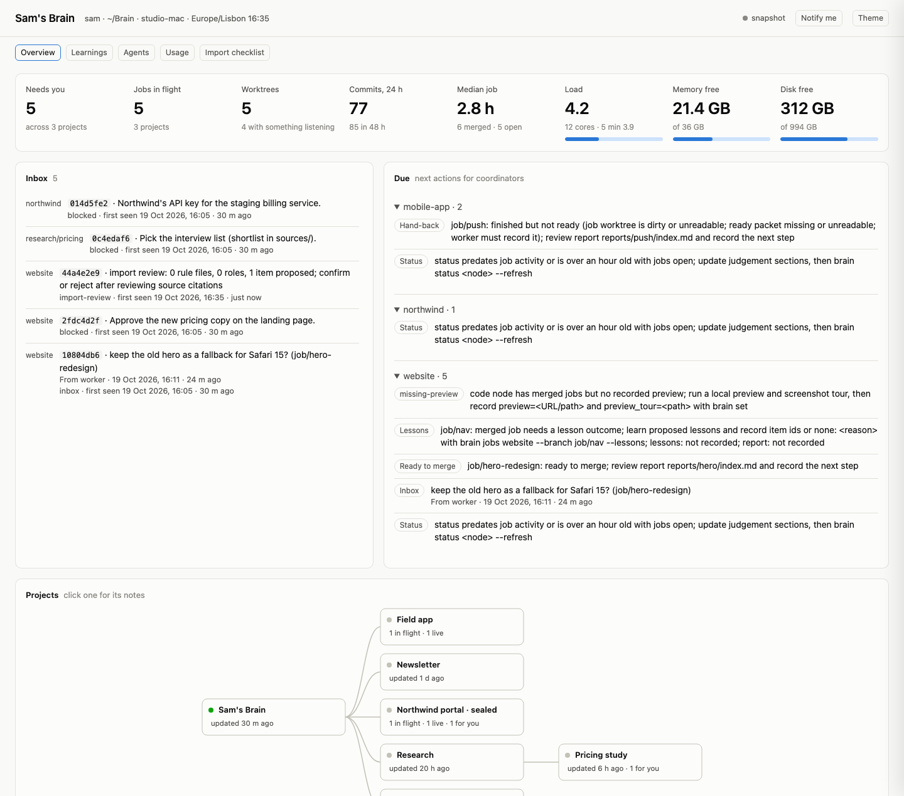
</picture>

<sub>`brain ui` on a demo brain. Every name, project and number in these images is made up.</sub>

</div>

---

## Quick start

```sh
curl -fsSL https://raw.githubusercontent.com/HadiKhai/brain-core/main/install.sh | sh
```

1. Answer a few questions (your id, the brain's name, the runtimes you use, your timezone).
2. Open your host (T3 Code, say) at `~/Brain` and say **"set up this machine"**.
3. Talk to the root: *"New project: the studio website, home at ~/code/website."*

The installer also starts one usage poller for the machine, so agents know how much of each
subscription is left before they start a job. Details in [Install](#install).

---

## Why

One agent in one repo for one afternoon works fine on its own. The trouble starts when the work is
bigger than one conversation:

| | A bare agent session | With a Brain |
| --- | --- | --- |
| **Memory** | The context window; long runs get compacted and details drift | State lives in files. Any thread can be replaced and picks up exactly where the last one stopped |
| **Decisions** | Somewhere in the chat. "What did I say about X?" becomes a guess | `decisions.md`, each with a timestamp, the reason, the alternatives and your exact words |
| **Many agents** | Nothing stops two of them from taking the same port or the same migration number | One worktree and a block of ports per job, one coordinator per project, a lock on shared files |
| **Many projects** | One repo per session; nothing sees across them | A tree. The root sees every project; each project sees only itself and what's below it |
| **Questions** | A worker asks on a screen nobody is watching | Workers hand questions back to their coordinator; only what the rules don't settle reaches you |
| **Quality** | The model that wrote the change reviews it, if anyone does | A different runtime reviews every change before you're asked to approve it |
| **Learning** | Lost when the session ends | Lessons from each finished job become library items the next job gets in its brief |
| **Consent** | Whatever you repeat in each session | Written rules: no push, deploy, send or anything irreversible without your explicit OK |

For a five-minute fix, open the repository itself or use a small brief. The Brain’s rules apply
in its nodes; a project’s own rules govern its home.

---

## How it works

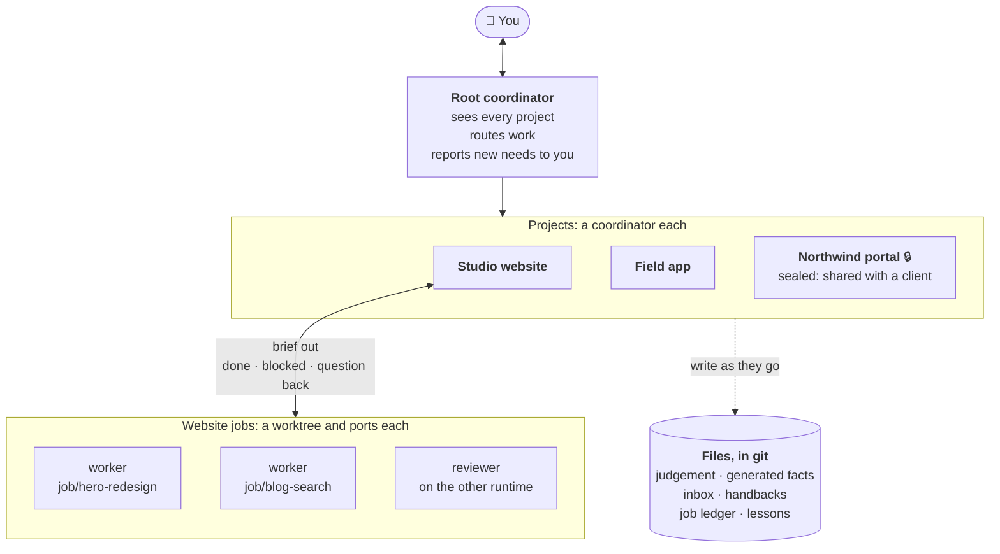

- **Nodes** form one tree of any depth: a company, a product, a client, a paper, a side project.
  Each node is a folder with a few files, and optionally its own code repository (its *home*).
- **A coordinator** is one long-lived conversation per node. You can talk to it directly, or to the
  root, which asks the coordinators below it.
- **Workers** do one job each, in their own git worktree with their own ports. They never ask you
  anything: a question goes back to the coordinator, which answers from the rules and the decisions
  already made, and only brings you what they don't settle.
- **Everything is a file.** Threads are disposable; when one ends (or hits a usage limit), the next
  one reads the files and carries on. A resume brief preserves the job’s commits and unfinished work.

### The files of a node

```
nodes/website/
├── node.md          id, owners, labels, runtime, where its home is
├── AGENTS.md        rules for this node (CLAUDE.md links to it)
├── brief.md         what it is, why, who, scope, Limits (each with "Why:" and "Lift when:")
├── status.md        coordinator judgement + generated facts (separate freshness times)
├── decisions.md     each decision: time, what, Why, Alternatives, and Said: "your exact words"
├── inbox.md         anyone may append a line; only the coordinator clears it
├── job-ledger.md    hours, commits, reviews, outcome, lessons and runtime switches
├── job-handbacks/   one worker-owned record per job: state, readiness, proposed lessons
├── never-name.txt   (optional) words this project's code must never contain
├── sources/         material the node works from
└── nodes/           its children, if any
```

One writer per file: the coordinator owns its node's files; everyone else appends to the inbox.
Machine-specific things (thread IDs, local paths, ports) live in `.brain/local.json`, which git
ignores, so the same brain works on every machine that clones it.

---

## A job, start to finish

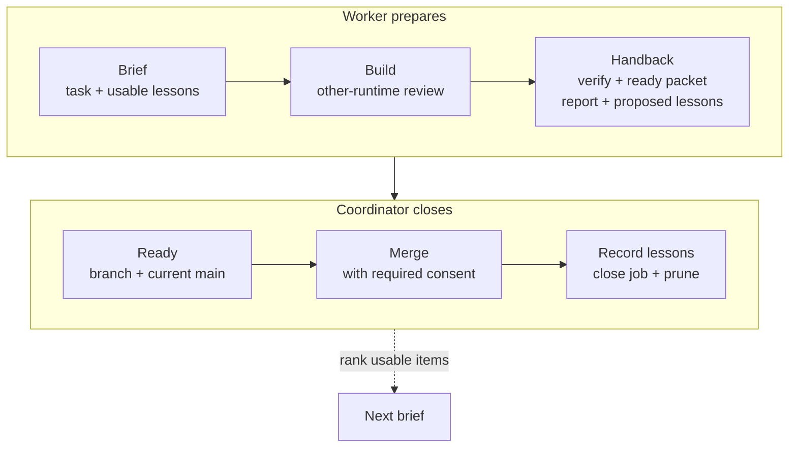

The worker builds in its worktree, gets review on another runtime, fixes findings, commits and
rebases on local `main`. One command finishes its part:

```sh
brain handback website --branch job/blog-search --state done --reviews 2 \
  --report reports/blog-search/index.md --lessons "Use title matches before recency."
```

It runs the node's configured verification, checks local main and stores the worker's state,
ready packet and proposed lessons together. For a blocker or question, use `--state blocked`
or `--state question`, omit `--reviews`, and describe it in the report. Questions reach the
inbox; a blocked human need adds `--need-human "<need>"`.

The coordinator runs `brain ready website --branch job/blog-search` immediately before merging.
It compares the worker’s packet with the branch and current local main; it does not rerun tests.
A moved main goes back to the worker. **Only the coordinator merges**, with required consent.
The packet records worker assertions, not independent proof.

At close, the coordinator saves reusable lessons with their source and scope, then records the
item ids with `brain jobs website --branch job/blog-search --lessons title-first` (or
`--lessons "none: <reason>"`). Briefs, hires and reviews automatically rank up to five usable
items by task, node and specialist. Proposed, rejected and quarantined items never enter a brief.

A clear, low-risk task taking minutes and changing no shared state can use
`brain brief website --small --task "Check the draft's links"`: one-line handback, no worktree,
ledger, review or ready packet. Growing scope returns to the full job flow.

### It wakes itself

A recurring host tick wakes each coordinator to run `brain due website` and check host pending
requests. It handles finished jobs, questions, missing lessons and previews. An empty tick ends
silently and changes no files. The host supplies the wake-up; the CLI supplies evidence.

`brain status website --refresh` generates the facts block in `status.md` from jobs, worktrees,
merges and attention counts. The coordinator writes the judgement around it. Refreshing facts
never makes old judgement look fresh.

`brain inbox root` is the human's one needs-you list. Items have stable ids;
`brain inbox root --new` reports each once per machine and reporter until resolved. Child
coordinators handle their own subtree and route unresolved needs upward. **The root reports to
the human.**

<details>
<summary><b>Inside a generated worker brief</b> (excerpt; <a href="docs/img/brief.txt">full demo capture</a>)</summary>

```markdown
## Task

Rank results by title match first, then recency. Done when the search page shows the 10 best results in under 100 ms.

## Relevant library items

- `flag-before-ship`: Ship UI changes behind a flag, measure, then switch — picked for task: then; same node. Read full: `brain item show flag-before-ship --node website`.
- `review-two-runtimes`: A second runtime reviews every change before you see it — picked for same node. Read full: `brain item show review-two-runtimes --node website`.
```

The full brief adds worktree, ports, subscription, host instance, resume state, limits and handback.
</details>

---

## See it

### In the terminal: `brain`

```text
Sam's Brain (sam)  ·  ~/Brain  ·  machine studio-mac

root                         updated 30m ago
  mobile-app                 updated 1h ago      in flight 1
  newsletter                 updated 1d ago
  northwind                  updated 3h ago      in flight 1 [sealed]
  research                   updated 20h ago
    pricing                  updated 6h ago
  website                    updated 12m ago     inbox 1  in flight 3

Needs attention
  - northwind: Northwind's API key for the staging billing service.
  - research/pricing: Pick the interview list (shortlist in sources/).
  - website: import review: 0 rule file(s), 0 role(s), 1 item(s) proposed; confirm or reject after reviewing source citations
  - website: Approve the new pricing copy on the landing page.
  - website: inbox: 2026-10-19 16:31 +01:00 from worker: question: keep the old hero as a fallback for Safari 15? (job/hero-redesign)
```

Demo captures: [due](docs/img/due.txt) · [inbox](docs/img/inbox.txt) · [usage](docs/img/usage.txt).

### Live in the browser: `brain ui --open`

A read-only dashboard on `127.0.0.1`: a calm control room, dark first, with a light mode, phone
layouts and keyboard navigation. Python serves its committed build with no Node or npm installation
needed, and it updates within seconds of any file changing.

- **Overview** answers what needs you, what moved and whether anything is stuck: counts with their
  trend, one mark per open thread, a 24-hour pulse of merges, questions and commits, subscription
  and machine meters, the first five items that need you and the threads moving now.
- **Inbox** holds every request and coordinator step, each with its action, search and paging.
- The sidebar is the brain's tree: projects, their coordinators and live threads, with a live dot
  and a needs-you count on each. A project's page shows its threads, jobs, activity and notes.
- **Agents** splits into Specialists, Jobs (the full ledger), Threads and Usage (subscription
  windows, measured spend, machine capacity). **Learnings** reviews proposals; **Graph** draws
  projects, specialists and learnings as a searchable graph that glows on matches and recent activity.
- Fields that point at another record (a project, a specialist) are searchable pickers backed by the
  server. Adding projects is a sheet beside the tree: discovered repositories become a reviewed
  `brain adopt` command.

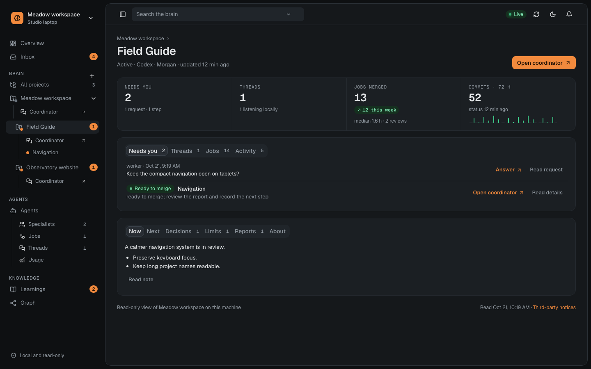

The page is for this machine only: it listens on `127.0.0.1`, refuses other hosts, and its data
needs a key that is printed with the address. Desktop notifications are opt-in, once per new
inbox item; saved ids survive reloads.

<details>
<summary><b>More views</b> (demo data; follows your light or dark theme)</summary>

<picture><source media="(prefers-color-scheme: dark)" srcset="docs/img/ui-inbox-dark.png">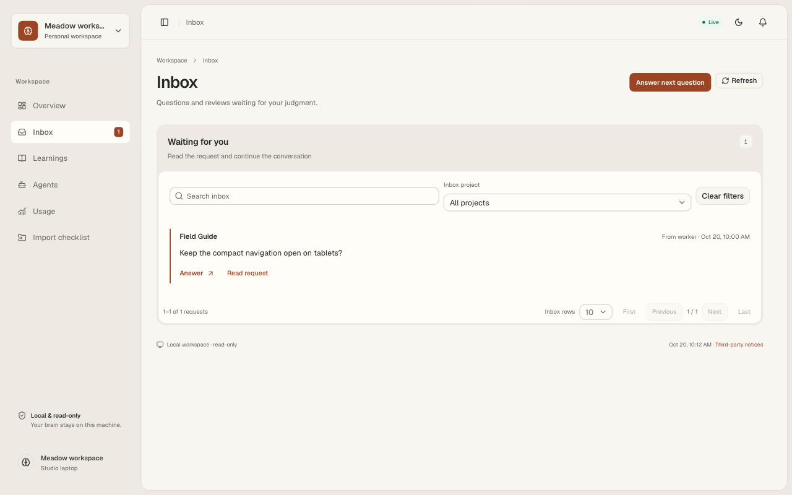</picture>

| Learnings | Jobs |
| --- | --- |
| <picture><source media="(prefers-color-scheme: dark)" srcset="docs/img/ui-learnings-dark.png">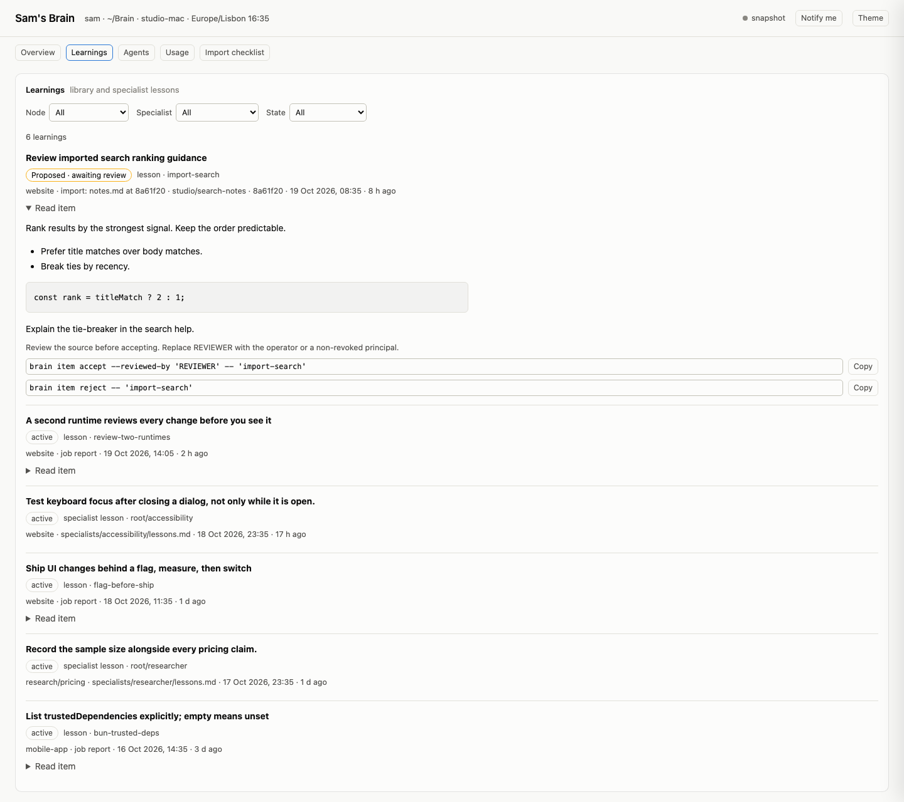</picture> | <picture><source media="(prefers-color-scheme: dark)" srcset="docs/img/ui-jobs-dark.png">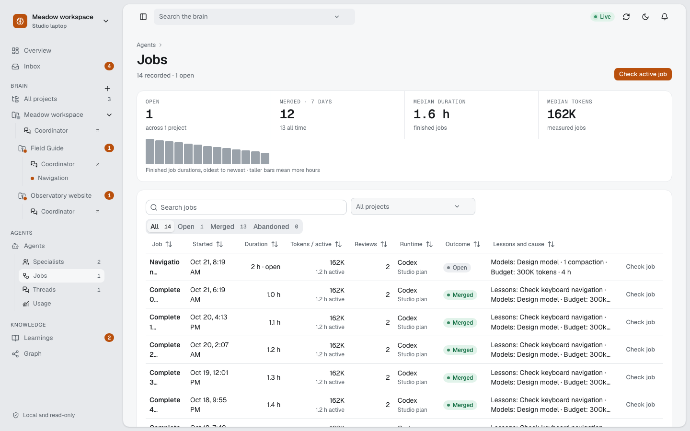</picture> |
| **Usage** | **Graph** |
| <picture><source media="(prefers-color-scheme: dark)" srcset="docs/img/ui-usage-dark.png">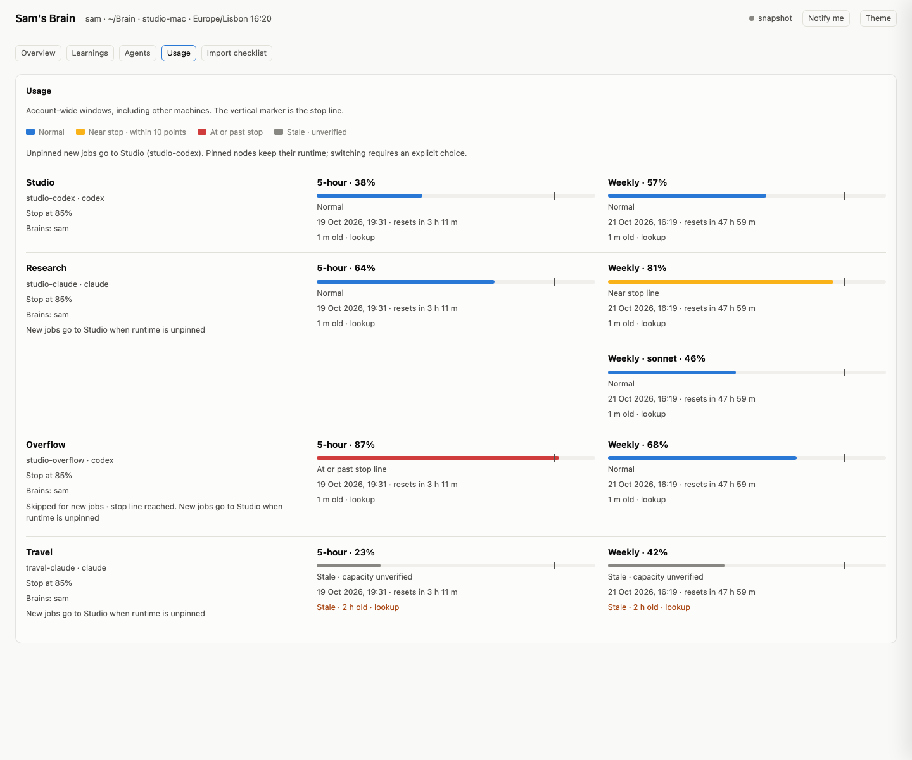</picture> | <picture><source media="(prefers-color-scheme: dark)" srcset="docs/img/ui-graph-dark.png">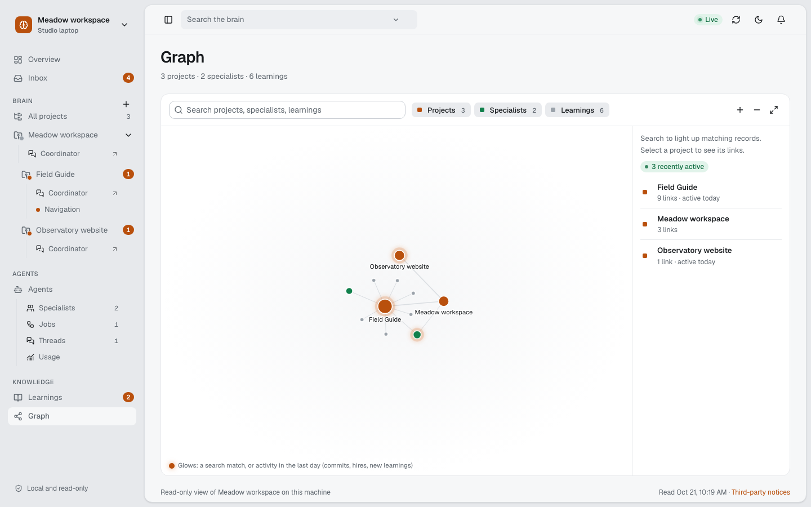</picture> |

</details>

### Measured, not guessed: `brain jobs`

```text
website: 7 finished (6 merged, 1 abandoned); median 2.8 h and 1.5 review round(s) per merged job; median 18.4M tokens and 1.1 active h (6 measured jobs)
  open  job/hero-redesign              7.5 h  2 review(s)  52.1M tokens   (over twice the median in hours and tokens)
        usage: 52.1M tokens processed (fresh in 610k, cache read 50.8M, cache write 520k, out 170k); active 2.4 h (agents 3.9 h); 412 tool calls; 4 compactions; 3 sub-agents, 61% of tokens; budget 30M tokens · 6 h: over (52.1M of 30M tokens, 7.5 of 6 h)
        advice: 4 compactions: past the context window again and again; hand back and restart from a brief with what is done so far
        advice: sub-agents spent 61% of its tokens: give them narrower tasks, or do the work in the main thread
  open  job/blog-search                3.1 h  0 review(s)  9.2M tokens
  cause superseded by the redesign
  blog: 1 similar jobs, too little data (need 3 merged jobs)
  all jobs on this node: 6 jobs, median 2.8 h, spread 1.1–5.6 h (observed min–max); of which 1.1 h active; 18.4M tokens processed (spread 6.2M–31M), of them 240k fresh input and output; from 6 measured jobs
```

Forecasts use this node’s merged jobs: sample count, median and observed min–max spread, in
wall hours and, for jobs measured since this ledger version, active hours and tokens. Fewer
than three samples means “too little data.” `brain jobs website --branch job/blog-search`
can include a planned job. Comparisons with reset windows describe serial job time; a
subscription says how full it is, not how many tokens a percent is, so whether the remaining
allowance fits stays unknown.

**Time and tokens.** When a job closes, `brain` reads the transcripts of the sessions that did
it on this machine and records in the ledger: tokens by kind (fresh input, cache reads and
writes, output, Codex reasoning), active hours (gaps over five minutes are idle) next to wall
hours, compactions, sub-agents and their share, tool calls and the models used. The sessions are
the ones started in the job's worktree, given a brief naming the job (a reviewer in its
coordinator's folder), or recorded by the worker's hand-back, plus every sub-agent they started.
Only aggregates are kept, never message text. A contract may set a budget (`## Budget`, e.g.
`30M tokens, 6 h`); the worker sees it, `brain handback` prints the spend against it, and
`brain jobs` and the live view flag jobs over budget, over twice the median, compacting three
times or more, or mostly spent by sub-agents. `brain spend website` looks back over every past
session about the home (opt-in, like `brain history`); `brain spend --machine` totals this
machine per runtime, per day and week.

Code projects should show a running local preview and a screenshot tour early. Record them with
`brain set website preview=http://localhost:4100 preview_tour=reports/preview/index.md`.
These paths stay machine-local. `due` reminds after merges if the preview is missing; old work
gets a reminder, not a failing check.

---

## Boundaries and privacy

Owners decide what a node can see. A node whose owners differ from its parent's is **sealed**:
its home is its own repository, and nothing inside it may name or depend on anything above it.

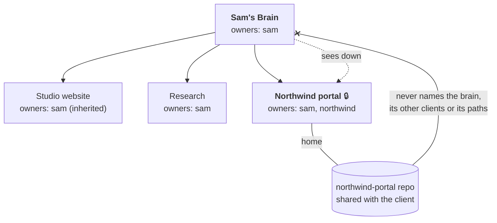

- **Sight goes down, never up.** A coordinator reads its descendants. A sealed project inherits
  nothing from above; context reaches it only in the briefs of its workers.
- **Words a project must never contain.** List them in the node's `never-name.txt` (a former
  client, a codename). `brain guard` and `brain check` look for them in the project's files, names,
  staged changes, submodules, branch names and commit messages, and never print the word itself.
  `brain brief` refuses a brief that contains one, and `brain wt add` refuses such a branch name.
- **Consent for what can't be undone.** Push, deploy, publish, send or delete needs your explicit
  OK, and the owners' for a shared project.
- **Knowledge has a scope.** A lesson learned in a client project is usable only where every owner
  of the using project is in its scope. Widening it needs everyone's consent.

---

## Several brains, several machines

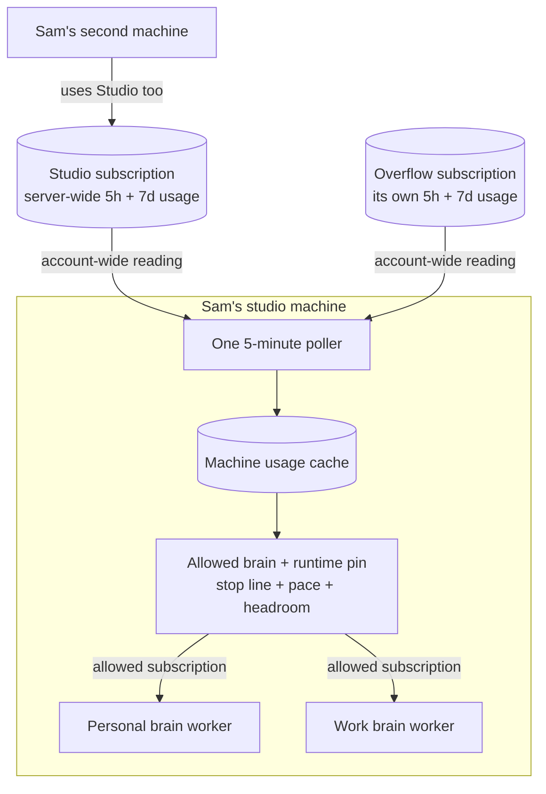

- **One command, any number of brains.** `brain` picks the brain whose folders you're in (its
  instance, or a project's code, workbench or worktree), else the one whose pointer is in the
  session's config folder, else the default. `brain -b work` picks one by name.
- **They never share a file.** A work brain can live only on the work laptop, with no remote at
  all; a personal one can follow you across machines with `install.sh --from <its git URL>`.
- **Per machine:** thread IDs, local paths, worktrees and ports stay in `.brain/local.json`.

### Usage follows the account

Machine-level `subscriptions.json` declares runtimes, config folders, host instances and allowed
brains, outside every brain. One `brain usage --watch --every 300` service polls every five minutes;
agents read the cache with `brain usage`. The installer starts it on macOS as a LaunchAgent
(`brain usage install`; `brain usage uninstall` removes it). See [machine setup](skills/machine-setup/SKILL.md#subscriptions-on-this-machine).

**Server readings are account-wide.** The same subscription on several machines has one
combined usage reading, not a fresh allowance per machine. Brain shows five-hour and seven-day
windows, reading age and resets. Stale or missing readings stay unknown, never spare capacity.

Before launch, routing filters by allowed brain and runtime, stops at the configured line
(default 85% of either applicable window), then favors weekly pacing and headroom. The machine's
fallback order breaks ties. Briefs name the subscription and host instance. A node's runtime
pin stays in force: at its limit, the brief names an alternative and waits for an explicit
`--runtime` choice. Pass `--model` for model-scoped limits. Without declared subscriptions,
existing runtime choices stay unchanged.

If a running AI hits a usage limit, the coordinator stops it, records the switch with
`brain jobs website --branch job/blog-search --switch "claude -> codex: usage limit"`, and
regenerates the brief with `--runtime codex`. The replacement continues in the same worktree
with the existing commits, handback and ledger state. If no eligible subscription remains,
it waits for a reset.

## Bring an existing project

Start with `brain scan ~/code --json`: read-only discovery. Choose the main repositories to
adopt, confirm the brain, parent and owners, then run `brain adopt ~/code/garden-notes`.
**Work and personal brains never mix.** Scan flags homes already assigned to another brain;
never adopt worktrees or nested repositories as separate projects.

Adopt records an import study job. `brain brief garden-notes --import` prepares a worker to
study local history and agent setup without changing the source repo or running its scripts.
`brain scrub garden-notes <path>` filters source evidence without revealing forbidden terms.
The study records cited decisions, unknowns and proposals, then finishes through `handback`.

The import study reads at most ten past AI sessions. To read all of them, `brain history
garden-notes` extracts every Claude and Codex conversation about the home, from each subscription
the brain may use, without a model. It keeps the operator's messages and the agent's replies,
drops tool output and copies, and filters secrets. Then it cuts them into batches that a reader
finishes before it would compact. Readers record each slice they read; `brain history
garden-notes check` shows what's covered and catches citations to turns that don't exist.
Readers note decisions and open threads, and the technical side too: how it's built, what broke
and what fixed it, the conventions you asked for. These go to the node's `knowledge.md` and to
proposed items and specialists other projects can use.

Once several projects are studied, `brain connect root` compares them: one reader digests each
project's files and a sample of its code, then a connector proposes what they share as items
and specialists, at their common ancestor and scoped to the owners they share. Review them all
with `brain proposals`, accept several at once, and every later brief in any project can use
them. Mid-task, `brain recall garden-notes "builds fail after the upgrade"` lists what every
project learned that this one may use.

Imported rules land in `sources/import-proposals.md` as **imported and unreviewed**; roles and
lessons start proposed and unusable. After actual review, accept a lesson with
`brain item accept <id> --reviewed-by sam`, or reject it with `brain item reject <id>`. Workers
never accept their own proposals. The coordinator reviews rules and roles before activating them.
Recording proposed ids in the ledger never accepts them.

---

## Install

A new brain (asks for your id, the runtimes you use and your timezone):

```sh
curl -fsSL https://raw.githubusercontent.com/HadiKhai/brain-core/main/install.sh | sh
```

The same brain on another machine:

```sh
curl -fsSL https://raw.githubusercontent.com/HadiKhai/brain-core/main/install.sh | sh -s -- --from <your brain's git URL>
```

A second brain on the same machine, with its own config folder:

```sh
curl -fsSL https://raw.githubusercontent.com/HadiKhai/brain-core/main/install.sh | sh -s -- --dir ~/WorkBrain --name work --global claude=~/.claude-work
```

The installer puts `brain` in `~/.local/bin` (on your PATH) and a short pointer in each runtime's
user-wide instructions, so an agent started anywhere knows where the brain is (`--no-global`
skips that). On macOS it also starts the machine's usage poller, a LaunchAgent that reads each
subscription's account-wide usage every five minutes (`--no-usage` skips it; `brain usage
uninstall` removes it later). A second brain on the same machine keeps the one poller. Then open your host at the brain's folder and say **"set up this machine"**: it creates
the projects and a coordinator thread for each node.

Then talk to it:

> *"New project: a pricing study for the studio, under research."*<br>
> *"What's waiting on me?"*<br>
> *"Website: add search to the blog. Ship behind a flag."*<br>
> *"Keep this as a lesson: list trusted dependencies explicitly."*

---

## Commands

You mostly talk to coordinators, and they run `brain` for you. By hand:

<details open>
<summary><b>See</b></summary>

| Command | Does |
| --- | --- |
| `brain` | dashboard: the tree, what needs you, coordinators |
| `brain ui [--open]` | the same, live in your browser (read-only, this machine only) |
| `brain show <node>` | everything about one node, with this machine's IDs and the status time in UTC |
| `brain jobs [node] [--branch B]` | job history and forecasts: samples, medians, spread, causes; open jobs' tokens so far and advice |
| `brain spend <node> [--since DATE] [--json]` | time and tokens of every past session about a node's home: opt-in, aggregates only, kept in `.brain/spend/` |
| `brain spend --machine [--since DATE] [--json]` | every session on this machine, per runtime, per day and week |
| `brain due [node]` | coordinator actions from files and local git; empty means silence |
| `brain due <node> --since-wake [--json]` | new file-only items for the latest wake, compared with the preceding wake's queue snapshot |
| `brain inbox [node] [--new]` | one needs-you list; stable ids, only-new reporting per machine and reporter |
| `brain status <node> --refresh` | regenerate facts without advancing judgement freshness |
| `brain usage` | allowed subscriptions, account-wide windows, age and resets |
| `brain stale <node> <host time>` | is a node's status behind its thread? Compares moments, whatever the timezones |
| `brain sync <node>` / `--all` | what happened in a node and its home since the last sync |
| `brain check [--fix] [--live]` | check mechanically and read cached webhook results; repair safe things with `--fix`; only `--live` sends a real probe |
| `brain machine` | this machine's bindings |
</details>

<details>
<summary><b>Shape the tree</b></summary>

| Command | Does |
| --- | --- |
| `brain new <id> --title T [--owners a,b] [--home path]` | create a node (ids nest with `/`) |
| `brain set <id> key=value` | fields; host IDs and home paths stay on this machine |
| `brain relabel`, `move`, `archive` | re-file a node |
| `brain split`, `merge` | reshape nodes, keeping provenance |
| `brain principal add <id>` | a new person, group or organization |
| `brain owners <id> a,b` | change owners |
| `brain seal <id> --owners a,b --home path` | give a node its own owners and home |
| `brain revoke <principal>` | end a relationship: quarantine its items and archive its nodes |
</details>

<details>
<summary><b>Run work</b></summary>

| Command | Does |
| --- | --- |
| `brain wt add/list/rm/prune` | one worktree per job beside the project's repo, with setup and a block of ports |
| `brain brief <id> [--branch B] --task-file F` | task, limits, routing, resume state and ranked usable lessons |
| `brain brief <id> --small --task "..."` | a minutes-long, low-risk task without job ceremony |
| `brain handback <id> --branch B --state done --reviews N --report P --lessons "..."` | one worker finishing step: verify, readiness, state and proposed lessons; also accepts blocked/question |
| `brain ready <id> --branch B` | compare the worker’s packet with branch and current local main before merge |
| `brain jobs <id> --branch B --contract-file F` | a job's contract: outcome, what the worker may do without asking, stop conditions, consent, done; optionally a budget |
| `brain jobs <id> --branch B --usage-file F` | a job's usage as its host reports it (JSON); it wins over what transcripts show |
| `brain set <id> 'verify_skip=docs/*,*.md'` | paths that can't affect verify: a green run survives changes to them |
| `brain set <id> 'verify_inputs=.env,config/*.local'` | untracked files verify reads (default `.env,.env.*`): a change to them means a fresh run |
| `brain jobs <id> --branch B --lessons "..."` | coordinator records learned item ids or `none: <reason>` at close |
| `brain review <id> --branch B` | a brief for a review by a runtime the builder didn't use |
| `brain guard <id> [path ...]` | the project holds none of the words in `never-name.txt` |
| `brain workbench <id>`, `brain report <id> "topic"`, `brain reports` | scripts and reports, in a predictable place |
| `brain schedule list/add/bind` | recurring work, shared; each machine runs what it binds |
| `brain now` | the time, in the brain's timezone, with its offset |
</details>

<details>
<summary><b>Knowledge</b></summary>

| Command | Does |
| --- | --- |
| `brain item add/list/show/scope/quarantine/restore` | the library, provenance and scopes |
| `brain item accept <id>... --reviewed-by sam` / `brain item reject <id>...` | review proposed learning; rejected items stay unusable |
| `brain proposals [node]` | everything waiting for review, in full, with commands to accept or reject several at once |
| `brain recall <node> "<problem>"` | what every project learned that this one may use, for a problem met mid-task |
| `brain connect <node> [check\|brief <child>\|brief --final]` | what the projects below a node share: digests, then proposed shared items and specialists |
| `brain usable <item> <node>` | may this node use this item? |
| `brain specialist new`, `brain lesson`, `brain hire` | reusable experts, their lessons, a brief that brings both |
</details>

<details>
<summary><b>Import, this machine and its brains</b></summary>

| Command | Does |
| --- | --- |
| `brain scan <folders> --json` | discover main repo candidates without writing |
| `brain adopt <paths> [--parent <node>]` | adopt selected homes and record import study jobs |
| `brain brief <node> --import` | study history into cited node state and inactive proposals |
| `brain scrub <node> [paths ...] [--check]` | filter evidence, or check outputs without exposing forbidden terms |
| `brain history <node> [plan\|check\|brief <batches>]` | every past AI conversation about a home, in batches readers finish; coverage check |
| `brain usage install` / `uninstall` | start or remove the machine's poller (macOS LaunchAgent; safe to rerun) |
| `brain usage --watch --every 300` | the poller itself, for other systems; agents only read |
| `brain link --global [runtime=folder ...]` | a pointer to this brain in runtimes' user-wide instructions |
| `brain brains`, `brain use <name>`, `brain -b <name> …`, `brain --all` | several brains: list, default, pick, every dashboard |
| `brain changes [node] [--seen]` | what changed in core for agents since this coordinator last read it |
| `brain version [--ref refs/remotes/origin/main] [--json]` | installed core SHA/date and local cached-origin comparison, with cache age; never fetches |
| `brain settings batch operations.json` | validate all set/schedule-add operations, then apply with one named-path bookkeeping commit |
| `brain set root auto_upgrade=on` | this machine upgrades core by itself whenever no job is open |
| `brain upgrade` | refuse while any job/worktree is open or its inventory is unreadable; once idle, update `core/`, link and check |
| `brain hook stop` / `brain hook approve` | the stop hook both runtimes run; trust it in Codex |
</details>

---

Settings batches use a UTF-8 JSON array. For example:

```json
[
  {"op": "set", "node": "root", "pairs": ["rotate_turns=42", "coordinator=sample-thread"]},
  {"op": "schedule-add", "id": "daily-check", "node": "root", "when": "daily 09:00", "brief": "Inspect the fixture"}
]
```

All operations validate before publication, including duplicate schedule IDs and machine-local
settings. Machine-local keys remain in `.brain/local.json`; shared settings and schedule
additions make one commit. Unrelated staged work stays staged. Targets with pre-existing
edits are refused. A publication failure leaves a private pending/failure packet in
`.brain/settings-batches/` with before/after contents: ask the coordinator before recovery.
There is no automatic rollback, host schedule creation or hourly squashing.

Worker, import, small-job and specialist briefs explicitly omit co-author attribution. They
supply no trailer for any runtime or model; explicit runtime/model selection does not invent
an attribution identity.

`brief_max_kb` (default 8) charges UTF-8 task and embedded context bytes captured before
assembly. Generated fixed instructions do not consume that allowance. Briefs warn above
the allowance and refuse at twice it. Both chargeable and total bytes are reported; at
256 KiB total output they refuse regardless of the allowance. Diagnostics identify the
coordinator-controlled source sections. Mandatory safety text is retained without truncation.

`brain version` compares with the locally cached origin default ref (or origin/main) and
labels unknown or diverged ancestry explicitly. Cache age observes the last available ref
reflog update, not a commit date or a guarantee about the remote; absent reflogs mean unknown
age. This command makes no network request. Existing daily update notices remain separate.

## What's in this repository

This repository is the **core**: it holds no one's data. Each brain is its own git repository and
uses the core as a submodule at `core/`, binding it in its `instance.md`.

| Path | What it is |
| --- | --- |
| [`MODEL.md`](MODEL.md) | primitives, the 24 axioms, procedures, and the runtime and host contracts. The source of truth |
| [`roles/`](roles) | the coordinator, worker and specialist protocols |
| [`skills/`](skills) | judgment procedures: import, jobs, review, learning, node changes and machine setup |
| [`templates/`](templates) | node, root, item, specialist and new-home templates |
| [`adapters/runtimes/`](adapters/runtimes) | one small file per agent runtime (Claude Code, Codex), with their stop hooks |
| [`adapters/hosts/`](adapters/hosts) | one mapping per host (T3 Code), plus a small `.env` the tool reads |
| [`bin/brain`](bin/brain) | the tool. Python 3.9+, standard library only |
| [`ui/`](ui/README.md) | React + shadcn dashboard; committed `ui/dist/` is served by Python with no runtime dependencies |
| [`install.sh`](install.sh) | one-line install: a new brain, another machine, or a second brain |
| [`tests/`](tests) | `brain selftest` and `live.py` |
| [`LICENSE`](LICENSE) | MIT |
| [`docs/`](docs) | these images, and the script that makes them from a demo brain |

---

## The model

Everything above follows from a small model: **principals** own **nodes** in one **tree**;
**boundaries** appear where owners change; **threads** run **roles** on **runtimes** inside a **host**;
**items** carry their provenance and scope. [`MODEL.md`](MODEL.md) has it in full.

<details>
<summary><b>The 24 axioms, in one line each</b></summary>

| # | Axiom |
| --- | --- |
| 1 | One tree, any depth; the root is a node like any other |
| 2 | Rules belong to nodes; labels carry none |
| 3 | Boundaries are derived from owners, never declared |
| 4 | Sight goes down |
| 5 | Inheritance goes down and stops at a boundary |
| 6 | No upward traces inside a sealed node |
| 7 | Nearest rules win |
| 8 | Layout follows sight: folders never load rules across a boundary |
| 9 | Context crosses a boundary only in briefs |
| 10 | Learning up is a citation, with provenance and a scope |
| 11 | Only the named owners can widen a scope |
| 12 | Teaching down is a native copy, through the receiver's own process |
| 13 | Relations live at the nearest common ancestor |
| 14 | Coordinators are recursive and optional |
| 15 | One writer per file; workers prepare, coordinators merge |
| 16 | State lives in files; handbacks, facts, ticks and resume survive threads |
| 17 | Full timestamps; reject status over five minutes ahead, warn on other future entries |
| 18 | Relabeling changes only labels |
| 19 | Transitions preserve provenance |
| 20 | Boundaries are recomputed after every transition |
| 21 | Revocation quarantines |
| 22 | Runtime neutrality: every axiom is tested on every runtime in use |
| 23 | Host and machine neutrality |
| 24 | Consent for what can't be taken back |
</details>

---

## Tests

Two layers: mechanical checks and real-agent scenarios. A passing unit suite does not prove
live billing reads, host launches or reviewer quality.

**`brain selftest`**: 214 tests in throwaway folders: the tree and its transitions, sealing
and traces, several brains on one machine, worktrees and ports, the job ledger, the guard (binary
files, Unicode, unreadable folders, submodules), locks under 16 parallel commands, the stop hook,
the live page and its key, timezones and future timestamps, handbacks and facts, inbox ids,
usage routing, imports, lessons, crash recovery, install and upgrade.

**`tests/live.py`**: the same use cases with real model calls, on **every** runtime in use (axiom 22),
judged by the files the agent leaves behind:

| Scenario | What a real agent must do |
| --- | --- |
| `parity`, `coordinator_writes_as_it_goes`, `worker_asks_the_writer` | load neutral rules; write timestamped decisions; respect file ownership |
| `learning_is_a_citation`, `lessons_become_items`, `limits_carry_their_reason` | preserve sources and scopes; learn at close; explain limits |
| `no_upward_traces`, `second_runtime_review` | respect sealed homes; review another runtime's change |
| `stop_hook_fires`, `notes_current_after_an_edit`, `freshness_across_timezones` | keep notes current and compare absolute times |
| `new_node_in_one_sentence`, `a_session_reaches_its_own_brain`, `worker_hands_back_a_question` | create a node; select the right brain; return an unresolved choice |
| `nine_` | capture close lessons; resume committed or dirty work; repair future status times |
| `usage_` | route before launch and respect a runtime pin |
| `autonomy_` | unified handback, finished-job wake, silent empty wake, subtree inbox and generated facts |
| `import_` | study history into cited decisions and unreviewed rules, roles and lessons |
| `r2_` | reuse a relevant lesson and finish a small job without ceremony |
| `recover_` | replace a coordinator, resume a worker on another runtime, route two jobs before launch |

```sh
brain selftest
python3 core/tests/live.py                     # every runtime in instance.md
LIVE_CODEX_BIN=/path/to/codex python3 core/tests/live.py --runtimes codex
```

The runner prints each executable and version, and stops calling a runtime that becomes
unavailable (a usage limit, say) instead of failing every remaining scenario. For the live page,
`tests/ui-checks.js` runs in a browser against the synthetic fixture: navigation, knowledge review,
subscription windows, import commands, tables and scroll geometry. See [dashboard development](ui/README.md). See [recovery rehearsals](docs/recovery.md) for real-agent fixtures, SIGKILL checks
and their limits. They test routing artifacts and file recovery, not real subscription exhaustion
or independent review quality.

---

## Changing the core

The core stays generic: if a change needs a specific name, it belongs in a brain, not here.
After any change:

1. `brain selftest`
2. `python3 core/tests/live.py` on every runtime
3. Follow [dashboard verification](ui/README.md) for UI changes and its synthetic screenshot tour.
   Use `python3 docs/make-screenshots.py --text-only` for CLI captures (fake data only).
4. commit here; brains pick it up with `brain upgrade`

---

## Licence

[MIT](LICENSE): free to use, copy, change and share, commercially or not. Keep the copyright
notice. It comes with no warranty.
